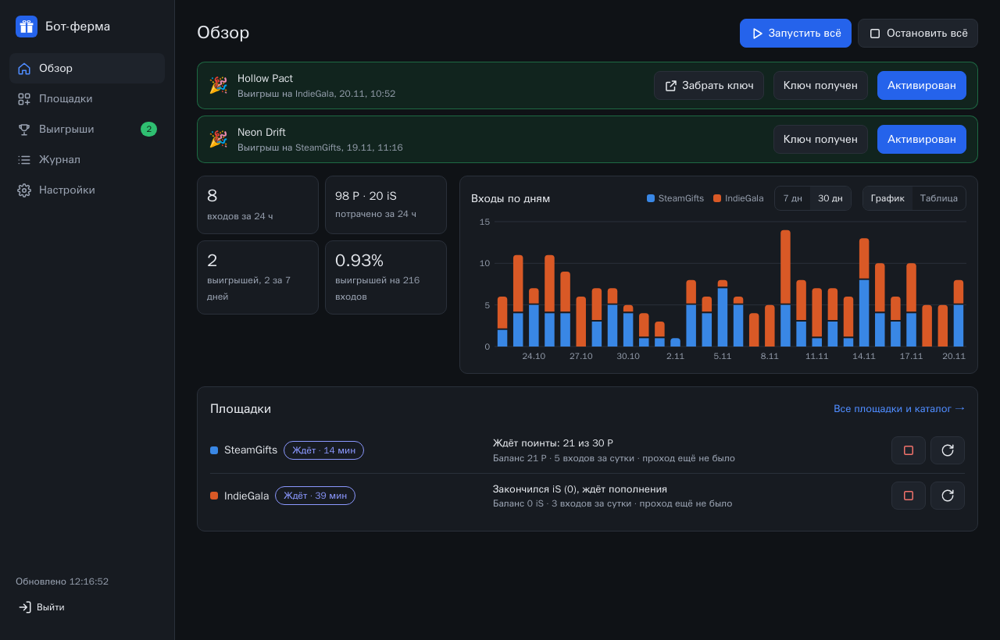
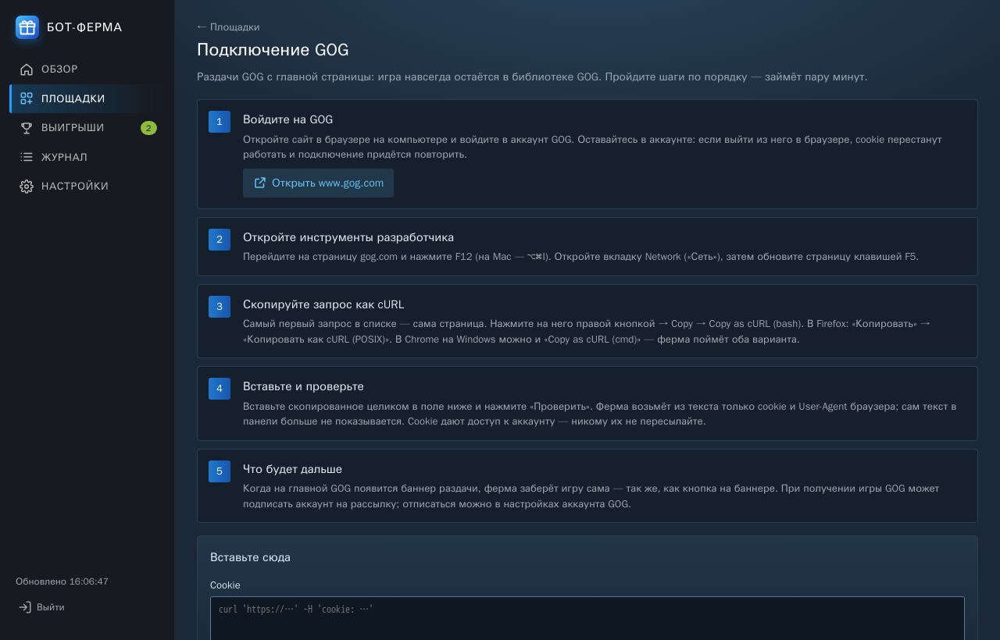
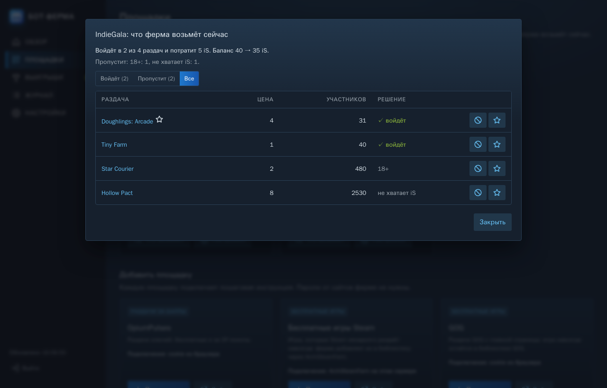
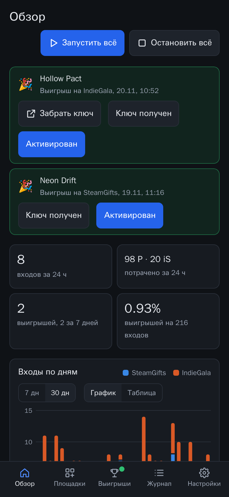

<div align="center">
  
</div>

<div align="center">

  [](https://github.com/PalmaLuv/SteamGiftBot/releases/latest)
  [](LICENSE)
  

</div>

Сам входит в раздачи игр и пишет в Telegram, когда вы что-то выиграли.

**[English version](README.md)** · **[Подробная вики](docs/wiki/Home.md)** — всё о каждой площадке, настройках, Telegram, ASF, сервере и разработке

Работать с SteamGiftBot можно двумя способами, установка у них общая:

- **Бот для командной строки** обходит [SteamGifts](https://www.steamgifts.com/) и
  входит в раздачи, на которые стоит тратить поинты. Одна площадка, сервер не
  нужен; есть готовый `.exe` для Windows и образ Docker.
- **Бот-ферма** одновременно работает с SteamGifts, IndieGala, OpiumPulses,
  бесплатными играми Steam (через ArchiSteamFarm), GOG и itch.io. Управляется из
  веб-панели, которую удобно открывать и с телефона.

<p align="center"></p>

**Содержание** · [Установка](#установка) · [Запуск фермы](#запуск-фермы) ·
[Подключение площадки](#подключение-площадки) · [Разделы панели](#разделы-панели) ·
[Правила](#правила-для-всех-площадок) · [Telegram](#telegram) ·
[ArchiSteamFarm](#archisteamfarm) · [Телефон](#панель-на-телефоне) ·
[Служба systemd](#ферма-как-служба) · [Безопасность](#безопасность) ·
[Бот для командной строки](#бот-для-командной-строки) · [Если что-то не так](#если-что-то-не-так)

---

## Установка

Нужен Python 3.10 или новее.

```bash
git clone https://github.com/PalmaLuv/SteamGiftBot.git
cd SteamGiftBot
python -m venv env
source env/bin/activate          # Windows: env\Scripts\activate
pip install -r requirements.txt
```

## Площадки

| Площадка | Что делает ферма | Как подключается |
| --- | --- | --- |
| [SteamGifts](https://www.steamgifts.com/) | входит в раздачи за поинты (P) | cookie из браузера |
| [IndieGala](https://www.indiegala.com/giveaways) | входит в раздачи за Galasilver (iS) | cookie из браузера |
| [OpiumPulses](https://www.opiumpulses.com/giveaways) | входит в бесплатные раздачи и раздачи за OP | cookie из браузера |
| Бесплатные игры Steam | добавляет в библиотеку игры, которые Steam раздаёт навсегда | запущенный [ArchiSteamFarm](https://github.com/JustArchiNET/ArchiSteamFarm) |
| [GOG](https://www.gog.com/) | забирает раздачу с главной страницы GOG | cookie из браузера |
| [itch.io](https://itch.io/games/on-sale) | забирает игры со скидкой 100% | cookie из браузера |

Ни одна площадка не получает ваш пароль. Ферма использует cookie, которые уже
есть в вашем браузере: их нужно один раз скопировать как *Copy as cURL*. Панель
по шагам показывает, как это сделать.

## Запуск фермы

```bash
python -m steamgiftbot.farm --set-password          # один раз: пароль панели
python -m steamgiftbot.farm --host 192.168.1.10     # адрес сервера в вашей сети
```

Откройте `http://192.168.1.10:8092/`, войдите, перейдите в раздел **Площадки** и
выберите сайт в каталоге.

- `--host` принимает несколько адресов через запятую, например домашний и Tailscale.
  Не используйте `0.0.0.0`: в панели хранятся cookie ваших аккаунтов, ей нечего
  делать в интернете.
- `--port` задаёт другой порт (по умолчанию 8092).
- `--no-autostart` запускает ферму с остановленными площадками.

## Подключение площадки

<p align="center"></p>

1. Войдите на сайт в браузере на компьютере.
2. Нажмите `F12`, откройте вкладку **Network** («Сеть») и обновите страницу.
3. Правой кнопкой по первому запросу → **Copy** → **Copy as cURL**. Подойдёт и
   вариант bash, и cmd.
4. Вставьте скопированное в панель и нажмите **Проверить подключение**. Ферма
   войдёт на сайт, ничего не сохраняя, и покажет аккаунт и баланс.
5. Выберите набор настроек: «Сбалансировано», «Экономно», «Максимум» или
   «Только игры». Затем нажмите **Сохранить и запустить**.

Из вставленного текста ферма сохраняет только cookie и User-Agent браузера. Если
сайт потом выкинет из аккаунта, карточка площадки станет красной и покажет
кнопку **Подключить заново**, а в Telegram придёт сообщение.

## Разделы панели

- **Обзор**: новые выигрыши, входы и траты за сутки, график входов по дням и
  все площадки. По каждой видно, почему она ждёт: «Ждёт поинты: 21 из 30 P»,
  «Вне часов работы, откроется в 08:00», «Дневной лимит исчерпан».
- **Площадки**: подключённые сайты и каталог. У каждой площадки своя страница
  с вкладками «Состояние», «Настройки», «Что возьмёт» и «Подключение». Площадки
  разделены по учёткам: у вас, брата или сестры свой набор сайтов, свои cookie,
  лимиты и история ([подробнее](https://github.com/PalmaLuv/SteamGiftBot/wiki/Несколько-учёток)).
- **Выигрыши**: все выигрыши со статусом («новый», «ключ получен»,
  «активирован»), ключом, если он есть, и кнопкой **Активировать в ASF**.
- **Журнал**: общий лог всех площадок с фильтрами и поиском, а также история
  входов с поиском, разбивкой на страницы и выгрузкой в CSV, которую открывает Excel.
- **Настройки**: часовой пояс, Telegram, библиотека Steam, ArchiSteamFarm,
  пароль панели и инструкция для телефона. Разделы сворачиваются, а вверху
  видно, что настроено, а что ещё нет.

**Что возьмёт.** Пробный проход показывает все текущие раздачи и что ферма
сделает с каждой. Ничего не тратит и никуда не входит:

<p align="center"></p>

Кнопки 🚫 и ★ рядом с игрой одним нажатием добавляют её в чёрный список или в
приоритетные. Те же кнопки есть в истории входов.

## Правила для всех площадок

- **Часы работы**, например `08:00-23:00` или `09:00-13:00, 18:00-02:00`, по
  часовому поясу фермы.
- **Дневные лимиты** на число входов и на траты.
- **Готовые фильтры**: пропускать DLC, саундтреки и паки; пропускать игры 18+;
  пропускать игры, которые уже есть в библиотеке Steam (для этого нужен ключ
  Steam Web API).
- **Сначала игры из списка желаемого Steam**: на IndieGala они идут первыми, а
  SteamGifts начинает каждый проход с раздела Wishlist.
- **Порядок smart на IndieGala**: сначала раздачи с лучшим шансом на потраченный
  iS, то есть с малым числом участников и дешёвым билетом. Есть список
  приоритетных игр, на которые можно тратить и резерв.

## Telegram

Настройки находятся в разделе **Настройки → Telegram**:

1. Создайте бота у [@BotFather](https://t.me/BotFather) командой `/newbot` и вставьте его токен.
2. Напишите своему боту любое сообщение.
3. Нажмите **Найти мой чат** и выберите свой чат. Потом нажмите **Сохранить** и **Отправить тест**.

Ферма присылает выигрыши, ошибки, сообщения о слетевших cookie и, если включить,
ежедневную сводку в выбранный час.

Если включить **Управлять фермой командами**, тот же бот начнёт отвечать на
команды, причём только в вашем чате:

| Команда | Что делает |
| --- | --- |
| `/status` | состояние каждой площадки |
| `/start indiegala`, `/start all` | запускает площадку или все сразу |
| `/pause steamgifts`, `/pause all` | останавливает |
| `/run indiegala` | запускает проход сейчас, не дожидаясь паузы |
| `/preview indiegala` | показывает, что ферма взяла бы сейчас |
| `/wins` | выигрыши без отметки |
| `/report` | сводка за сутки |

Команды, отправленные, пока ферма была выключена, не выполняются задним числом.

## ArchiSteamFarm

Если запущен [ASF](https://github.com/JustArchiNET/ArchiSteamFarm), ферма умеет
активировать выигранные ключи и забирать бесплатные игры Steam. Ключ можно
активировать вручную из раздела «Выигрыши» или сразу, как только он появится:
это включается настройкой «Активировать выигранные ключи сразу».

Несколько учёток Steam — это несколько ботов ASF. Бесплатные игры ферма
добавляет всем ботам (или выбранным в поле «Боты ASF»), а ключи каждой учётки
идут в её Steam: «Площадки» → учётка → «Настроить» → бот ASF.

Если ASF работает на этом же сервере и в `~/asf/config/ASF.json` задан
`IPCPassword`, ничего вписывать не нужно. Если ASF на другом компьютере, укажите
его адрес и пароль в **Настройки → ArchiSteamFarm** и нажмите **Проверить ASF**.

## Панель на телефоне

<p align="center"></p>

- **Дома.** Телефон должен быть в той же Wi-Fi сети, что и сервер. Откройте
  адрес панели и добавьте её на главный экран:
  - Android, Chrome: **⋮ → Добавить на главный экран**;
  - iPhone, Safari: **Поделиться → На экран «Домой»**.
- **Вне дома.** Поставьте на телефон [Tailscale](https://tailscale.com/), войдите
  тем же аккаунтом, что и на сервере, и откройте адрес сервера вида
  `http://100.x.x.x:8092`.
- **По http** браузер добавит панель как ярлык. Чтобы панель ставилась как
  полноценное приложение, нужен https, например `sudo tailscale serve --bg 8092`.

Подробная инструкция для Android, iPhone и Tailscale, со списком частых проблем,
есть в самой панели: **Настройки → Панель на телефоне**.

## Ферма как служба

[`deploy/botfarm.service`](deploy/botfarm.service) — юнит systemd. Впишите в него
своего пользователя, путь к проекту и адрес, затем выполните:

```bash
sudo cp deploy/botfarm.service /etc/systemd/system/
sudo systemctl daemon-reload
sudo systemctl enable --now botfarm
```

После обновления кода: `sudo systemctl restart botfarm`. Настройки, изменённые в
панели, начинают действовать без перезапуска.

Если панель не открывается с другого устройства, скорее всего, порт закрыт
фаерволом. Для `ufw`:

```bash
sudo ufw allow from 192.168.1.0/24 to any port 8092 proto tcp
```

**Где что хранится.**

- `farm.json`: пароль панели, cookie и настройки площадок.
- `botfarm-state.json`: история и счётчики по дням.
- `config.ini`: SteamGifts и Telegram.

Все три файла уже в `.gitignore`. Первые два ферма создаёт с доступом только для
владельца; для `config.ini` сделайте то же: `chmod 600 config.ini`.
[`scripts/backup-farm.sh`](scripts/backup-farm.sh) делает ежедневные копии этих
файлов.

## Безопасность

- Вход в панель — по паролю, который хранится как хэш PBKDF2. После входа
  браузер получает cookie с флагами HttpOnly и SameSite=Strict. После 10
  неверных паролей адрес блокируется на 10 минут.
- Каждый POST-запрос должен нести заголовок, который нельзя отправить из формы
  на чужом сайте.
- API никогда не отдаёт сохранённые cookie, токены и пароли, только признак
  «задано».
- Смена пароля или кнопка «Выйти на всех других устройствах» завершают все
  остальные сессии.

## Бот для командной строки

Если нужна только SteamGifts и без сервера:

```bash
python main.py               # первый запуск задаст вопросы и сохранит config.ini
python main.py --dry-run     # покажет, куда вошёл бы, ничего не тратя
python main.py --help        # все параметры
```

Для Windows есть готовый `SteamGiftBot.exe` в
[релизах](https://github.com/PalmaLuv/SteamGiftBot/releases/latest), для Docker —
образ `ghcr.io/palmaluv/steamgiftbot`. Все настройки, фильтры и запуск по
расписанию подробно описаны в [английском README](README.md#first-run).

## Если что-то не так

- **Площадка «Нужен вход заново».** Сайт перестал узнавать cookie. Откройте
  площадку и нажмите **Подключить заново**.
- **IndieGala ни во что не входит.** Посмотрите вкладку «Что возьмёт»: там видна
  причина. Чаще всего закончились iS или указан не тот уровень аккаунта.
- **SteamGifts пишет «Подходящих раздач нет».** На текущий баланс ничего не
  проходит фильтры. Ферма подождёт поинты и попробует снова.
- **Не приходят сообщения в Telegram.** В разделе Настройки → Telegram нажмите
  **Отправить тест**: появится ошибка от Telegram.
- **Панель не открывается.** Проверьте, что служба работает
  (`systemctl status botfarm`), что адрес в `--host` правильный и что порт
  открыт в фаерволе.

## Разработка

```bash
pip install -r requirements-dev.txt
pytest            # все тесты, без сети и без cookie
ruff check .
```

## Лицензия

[MPL-2.0](LICENSE).
