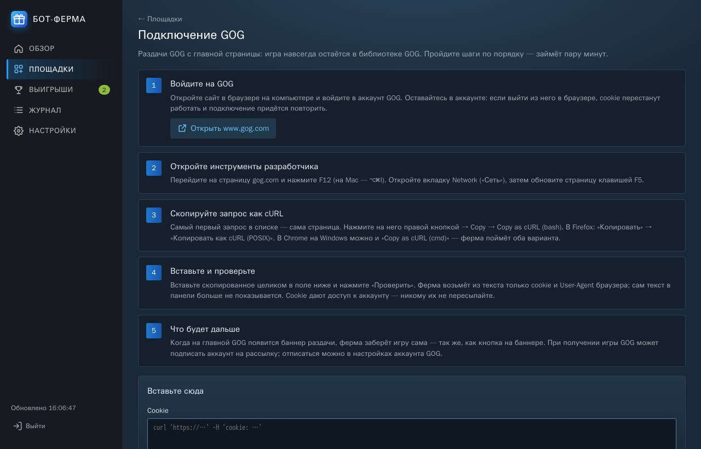

# Connecting sites

The farm signs in to sites as you, but it does not need your passwords. It
uses cookies: short strings by which a site recognises that you are already
signed in. You copy them from your browser once.

The exception is [Free Steam games](Free-Steam-Games-EN.md): that site works
through ArchiSteamFarm and needs no cookies.

## What it looks like in the panel

1. **Sites (Площадки) → Add site (Добавить площадку) → Connect (Подключить)**
   next to the site you want.
2. The wizard shows the steps: sign in to the site, open the developer tools,
   copy the request.
3. Paste what you copied into the field and press **Test connection
   (Проверить подключение)**. The farm signs in to the site without saving
   anything and shows the account and the balance.
4. Choose a preset (see [Rules and filters](Rules-and-Filters-EN.md#presets))
   and press **Save and start (Сохранить и запустить)**.

## How to copy a request as cURL

Do this on a computer: mobile browsers have no developer tools.

### Chrome, Edge, Yandex Browser, Opera, Brave

1. Open the site and sign in.
2. Press `F12`, or `⌥⌘I` on a Mac. Alternatively, right-click the page →
   **Inspect**.
3. Open the **Network** tab. If you cannot see it, click `»` in the row of
   tabs.
4. Reload the page with `F5`.
5. Scroll the list of requests to the very top. The first row is the page
   itself, for example `giveaways` or `www.indiegala.com`.
6. Right-click it → **Copy** → **Copy as cURL (bash)**. On Windows,
   **Copy as cURL (cmd)** works too.
7. Paste it into the field in the panel (`Ctrl+V`).

### Firefox

1. Sign in to the site, press `F12` and open the **Network** tab.
2. Reload the page (`F5`).
3. Right-click the first request → **Copy Value** →
   **Copy as cURL (POSIX)**.

### Safari

1. Turn on the developer menu: **Safari → Settings → Advanced → "Show features
   for web developers"**.
2. **Develop → Show Web Inspector → Network**, then reload the page.
3. Right-click the first request → **Copy as cURL**.

## What else you can paste

The farm understands several formats. Any of them works:

| Format | Where to get it |
| --- | --- |
| cURL (bash or cmd) | the developer tools, as described above. **Recommended:** along with the cookies, the farm also takes your browser's User-Agent |
| JSON | the Cookie-Editor extension → Export → JSON |
| Netscape `cookies.txt` | extensions like "Get cookies.txt" |
| A `Cookie: a=1; b=2` line | the request header in the Network tab |
| A single value | SteamGifts only: the `PHPSESSID` value |

From the pasted text the farm keeps only the cookies and the User-Agent. It
throws everything else away, and the panel never shows that text again.

## Important

- **Do not sign out in the browser.** The site's "Sign out" button invalidates
  the cookies, and you will have to connect again. Just close the tab.
- **Take the cookies from the same browser you signed in with.** IndieGala is
  protected by Incapsula and matches the cookies against the browser, so the
  farm also needs the User-Agent. When you copy as cURL it is included
  automatically.
- **Cookies give access to your account.** Do not send them to anyone and do
  not post screenshots that show them.
- **Cookies stop working after a while.** Usually after a few weeks. Then the
  site's card turns red with a **Reconnect (Подключить заново)** button, and a
  message arrives on Telegram. Repeat the same steps.

## If the test fails

| Panel response | What to do |
| --- | --- |
| "No cookies in the text" («В тексте нет cookie») | you copied the wrong request or only part of it. Take the very first request of the page and paste all of it |
| "… does not recognise the cookies" («… не узнаёт cookie») | you are not signed in to the site in the browser, or you signed in in another window, for example in incognito mode. Sign in, reload the page and copy the request again |
| "IndieGala showed an Incapsula check" («IndieGala показала проверку Incapsula») | open the site in the browser, pass the check and copy the request as cURL again |
| "No itchio in the cookies" («В cookie нет itchio») | you are not signed in to itch.io, or you copied a request that is not from itch.io |
| "… is unavailable" («… недоступен») / "HTTP 5xx" | the site is temporarily down; try again later |

## Updating cookies or disconnecting a site

Open the site → the **Connection (Подключение)** tab:

- **Reconnect** opens the same wizard. Settings and history are kept.
- **Disconnect (Отключить)**: the farm stops the site and forgets its cookies.
  History and settings remain, and you can connect again at any time.

## Another person's sites

Create a profile for them (Sites → "+ New profile" («+ Новая учётка»)) and
connect sites in it the same way, except that you copy the request from
another browser profile or an incognito window where their account is open.
Details are in [Multiple profiles](Multiple-Profiles-EN.md).
