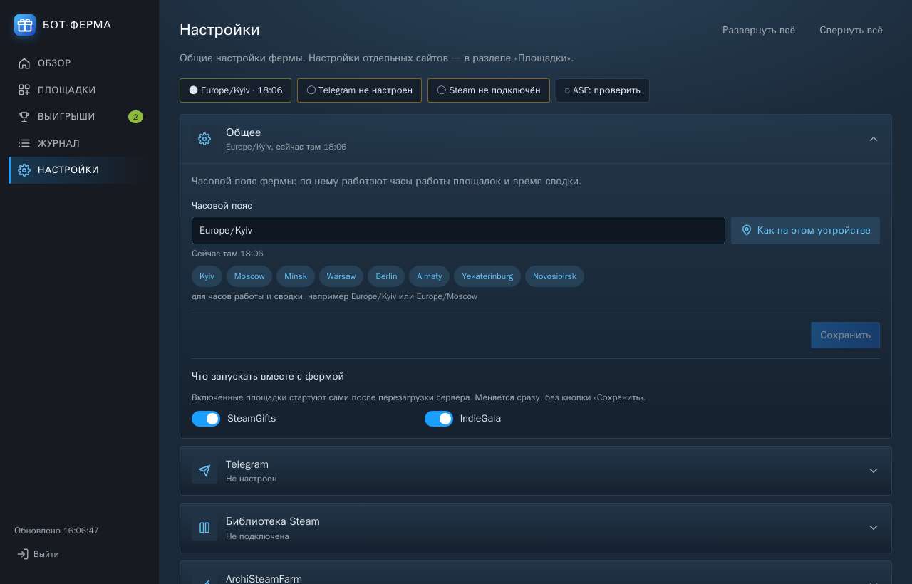

# Farm settings

The **Settings (Настройки)** section holds the settings of the whole farm.
The settings of individual sites are in the **Sites (Площадки)** section, on
each site's page.

## How the page is laid out

- **The status bar at the top** shows the time zone and the time in it,
  whether Telegram is set up and whether Steam is connected, and lets you
  check ASF. Clicking it opens the relevant section.
- **Sections collapse.** The panel remembers which ones you left open. At the
  top there are "Expand all" («Развернуть всё») and "Collapse all" («Свернуть
  всё»).
- **Each section has its own "Save" («Сохранить») button.** It lights up only
  when something has changed. Changes take effect at once, without restarting
  the farm.
- **Saved secrets** (tokens, keys, passwords) are shown as "✓ Saved"
  («✓ Сохранено») with a "Replace" («Заменить») button. They are never sent
  back to the browser.

## Look and language

Applies at once, without a Save button, and is remembered for all your devices.

- **Panel language**: Russian, English or Ukrainian. Labels, buttons and the
  farm's own log messages are translated; game names and the sites' replies
  stay as they are.
- **Theme**: "Classic", "Graphite", "Midnight" (near-black, for OLED) and
  "Light".
- **Accent colour**: the colour of buttons, links and highlights: seven presets
  or any colour of your own.
- **Scale** (90–125 %), **corners** (square or rounded), **background glow** and
  **animations**.
- **Show the tour again**: a short walk through the sections. It opens by
  itself on the first sign-in; "Skip" or Esc closes it.
- **Reset**: the default theme and colours (the language stays).

## General

- **Time zone (Часовой пояс).** You can pick one from the full list (start
  typing a city in English: Kyiv, Moscow, Almaty), press "Same as this device"
  («Как на этом устройстве») or one of the buttons with common zones. Under
  the field you can see the current time in the chosen zone.
- **Start with the farm (Что запускать вместе с фермой).** A toggle for each
  connected site. Sites that are switched on start by themselves after the
  farm or the server restarts. The change takes effect at once; no "Save"
  button is needed.

## All settings

**General (Общее)**

| Setting | Default | What it does |
| --- | --- | --- |
| Time zone | `Europe/Kyiv` | for working hours and the summary, for example Europe/Kyiv or Europe/Moscow |

**Steam library (Библиотека Steam)**

| Setting | Default | What it does |
| --- | --- | --- |
| Steam Web API key | — | steamcommunity.com/dev/apikey; needed to skip games you already own |
| Steam profile (Профиль Steam) | empty | a SteamID64 or a profile link; "Game details" must be public |
| Wishlist games first (Сначала игры из списка желаемого) | off | IndieGala takes them first (and may spend the reserve), SteamGifts starts every run with the "Wishlist" section; the wishlist must be public |

**ArchiSteamFarm**

| Setting | Default | What it does |
| --- | --- | --- |
| IPC address (Адрес IPC) | `http://127.0.0.1:1242` | if ASF is on the same server, leave it as is |
| IPC password (Пароль IPC) | — | IPCPassword from config/ASF.json; empty means the farm reads it from ~/asf/config/ASF.json by itself |
| Bot for keys (Бот для ключей) | empty | an ASF bot name; empty means the first bot online |
| Activate won keys immediately (Активировать выигранные ключи сразу) | off | as soon as a win has a key, ASF activates it and the result arrives on Telegram |

**Telegram**

| Setting | Default | What it does |
| --- | --- | --- |
| Bot token (Токен бота) | — | create a bot with @BotFather using /newbot and paste the token it sends |
| Chat ID (ID чата) | empty | send the bot any message and press "Find my chat" («Найти мой чат») |
| Send notifications (Присылать уведомления) | on | wins, errors, expired cookies |
| Control the farm with commands (Управлять фермой командами) | off | /status, /pause, /start, /run, /preview, /wins, /report; replies only in this chat |
| Send daily summary (Присылать сводку за сутки) | off | entries, spending, wins and balance for each site |
| Summary hour (Час отправки сводки) | `21` | 0–23, in the farm's time zone |

The Telegram settings (token, chat, "Send notifications") are stored in
`config.ini`, because the command-line bot uses them too. Everything else is
in `farm.json`.

## Check buttons

| Button | What it does |
| --- | --- |
| Telegram → "Find my chat" | shows the chats where someone wrote to the bot; the one you pick is filled into the field |
| Telegram → "Send test" («Отправить тест») | sends a test message |
| Telegram → "Send summary now" («Прислать сводку сейчас») | sends the daily summary without waiting for the summary hour |
| Steam library → "Check" («Проверить») | shows how many games are in the library and the wishlist, or why they could not be read |
| ArchiSteamFarm → "Check ASF" («Проверить ASF») | shows the ASF bots and which of them are online |

## Security

- **Change password (Сменить пароль)**: enter the current and the new one (at
  least 6 characters). After the change, every other device is signed out of
  the panel.
- **Sign out on all other devices (Выйти на всех других устройствах)**: the
  same, but the password stays as it was. Handy if you lose your phone.

## Panel on your phone and "About the farm"

Step-by-step instructions are on the [Panel on your phone](Mobile-Panel-EN.md)
page. The "About the farm" («О ферме») section shows the start time, the
panel addresses, how many sites are connected and the time in the farm's time
zone.
