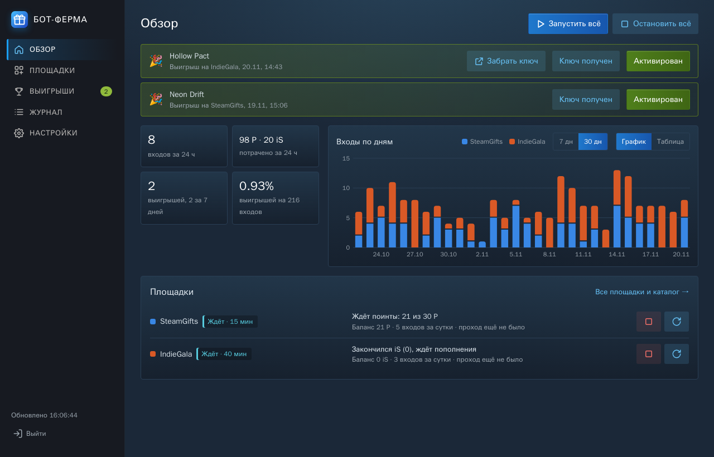

🇷🇺 [Русская версия](Home.md)

# SteamGiftBot wiki

SteamGiftBot enters game giveaways on its own and messages you on Telegram
when you win something. This wiki covers everything from installation to
adding your own site to the farm.

## Getting started

1. [Installation](Installation-EN.md): Python, a virtual environment, dependencies.
2. [First farm run](First-Farm-Run-EN.md): panel password, address, first site.
3. [Connecting sites](Connecting-Sites-EN.md): how to copy a cookie as cURL
   in any browser.

Only need SteamGifts and no server? Then read
[Command-line bot](Command-Line-Bot-EN.md).

## The farm and the command-line bot

| | Command-line bot | Bot farm |
| --- | --- | --- |
| Sites | SteamGifts | SteamGifts, IndieGala, OpiumPulses, free Steam games, GOG, itch.io |
| Control | terminal, `config.ini` | web panel (phone included) and Telegram commands |
| Where it runs | anywhere; there is an `.exe` and Docker | on a server or a home computer that stays on |
| Trying it without spending | `--dry-run` | the Preview (Что возьмёт) tab |
| Working hours, limits, presets | — | yes |
| Key activation through ASF | — | yes |

## Sites

| Site | What it does | Connection |
| --- | --- | --- |
| [SteamGifts](SteamGifts-EN.md) | giveaways for points (P) | cookie |
| [IndieGala](IndieGala-EN.md) | giveaways for Galasilver (iS) | cookie |
| [OpiumPulses](OpiumPulses-EN.md) | free giveaways and giveaways for OP | cookie |
| [Free Steam games](Free-Steam-Games-EN.md) | games Steam gives away to keep forever | ArchiSteamFarm |
| [GOG](GOG-EN.md) | the giveaway on the GOG home page | cookie |
| [itch.io](itch-io-EN.md) | games at 100% off | cookie |

## Everything else

- **Panel:** [Web panel](Web-Panel-EN.md) · [Farm settings](Farm-Settings-EN.md) ·
  [Rules and filters](Rules-and-Filters-EN.md) · [Wins and keys](Wins-and-Keys-EN.md) ·
  [Log and history](Log-and-History-EN.md)
- **Connections:** [Telegram](Telegram-EN.md) · [ArchiSteamFarm](ArchiSteamFarm-EN.md) ·
  [Panel on your phone](Mobile-Panel-EN.md)
- **Server:** [Server and service](Server-and-Service-EN.md) · [Security](Security-EN.md) ·
  [Files and data](Files-and-Data-EN.md)
- **Reference:** [Troubleshooting](Troubleshooting-EN.md) · [Panel API](Panel-API-EN.md) ·
  [Development](Development-EN.md)

The [README](../../README.md) also has English documentation.
