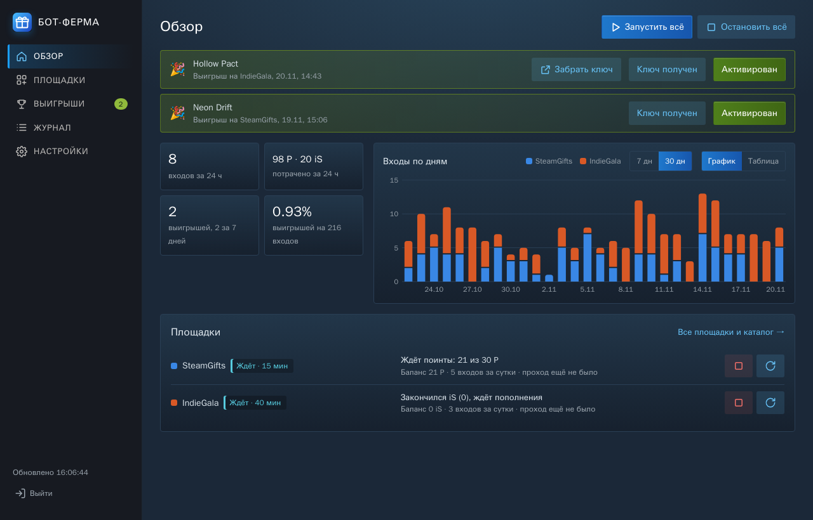

🇬🇧 [English version](Home-EN.md)

# SteamGiftBot — вики

SteamGiftBot сам входит в раздачи игр и пишет в Telegram, когда вы что-то
выиграли. Здесь собрано всё: от установки до того, как добавить в ферму свою
площадку.

## С чего начать

1. [Установка](Установка.md): Python, виртуальное окружение, зависимости.
2. [Первый запуск фермы](Первый-запуск-фермы.md): пароль панели, адрес, первая площадка.
3. [Подключение площадок](Подключение-площадок.md): как скопировать cookie как cURL
   в любом браузере.

Нужна только SteamGifts и без сервера? Тогда читайте
[Бот для командной строки](Бот-для-командной-строки.md).

## Ферма и бот для командной строки

| | Бот для командной строки | Бот-ферма |
| --- | --- | --- |
| Площадки | SteamGifts | SteamGifts, IndieGala, OpiumPulses, бесплатные игры Steam, GOG, itch.io |
| Управление | терминал, `config.ini` | веб-панель, в том числе с телефона, и команды Telegram |
| Где работает | где угодно, есть `.exe` и Docker | на сервере или домашнем компьютере, который не выключается |
| Проверка без трат | `--dry-run` | кнопка «Что возьмёт» |
| Часы работы, лимиты, наборы настроек | — | есть |
| Активация ключей через ASF | — | есть |

## Площадки

| Площадка | Что делает | Подключение |
| --- | --- | --- |
| [SteamGifts](SteamGifts.md) | раздачи за поинты (P) | cookie |
| [IndieGala](IndieGala.md) | раздачи за Galasilver (iS) | cookie |
| [OpiumPulses](OpiumPulses.md) | бесплатные раздачи и раздачи за OP | cookie |
| [Бесплатные игры Steam](Бесплатные-игры-Steam.md) | игры, которые Steam раздаёт навсегда | ArchiSteamFarm |
| [GOG](GOG.md) | раздача с главной страницы GOG | cookie |
| [itch.io](itch-io.md) | игры со скидкой 100% | cookie |

## Всё остальное

- **Панель:** [Веб-панель](Веб-панель.md) · [Настройки фермы](Настройки-фермы.md) ·
  [Правила и фильтры](Правила-и-фильтры.md) · [Выигрыши и ключи](Выигрыши-и-ключи.md) ·
  [Журнал и история](Журнал-и-история.md)
- **Связь:** [Telegram](Telegram.md) · [ArchiSteamFarm](ArchiSteamFarm.md) ·
  [Панель на телефоне](Панель-на-телефоне.md)
- **Сервер:** [Сервер и служба](Сервер-и-служба.md) · [Безопасность](Безопасность.md) ·
  [Файлы и данные](Файлы-и-данные.md)
- **Справка:** [Частые проблемы](Частые-проблемы.md) · [API панели](API-панели.md) ·
  [Разработка](Разработка.md)

English documentation is in the [README](../../README.md).
