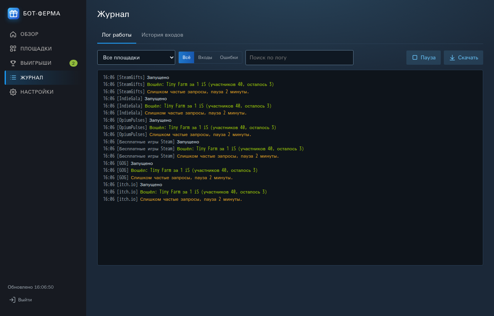

# Log and history

The **Log (Журнал)** section has two tabs.

## Activity log

The latest log lines of all sites together, in time order. Each line starts
with the site's name.

- **Site (Площадка)**: show only one site.
- **All / Entries / Errors / Detailed (Всё / Входы / Ошибки / Подробно)**:
  every line, only giveaway entries, only warnings and errors, or everything
  plus the reason each giveaway was skipped ("Skipped: Name — above the limit").
  The detailed lines exist only in the panel; they are not written to the log
  file.
- **Search (Поиск)**: lines that contain all of the words you typed.
- **Pause (Пауза)**: stop refreshing so you can read in peace.
- **Download (Скачать)**: save the lines shown to `botfarm-log.txt`.

Entries are highlighted in green, warnings in yellow, errors in red. Every
line has the time with seconds, and lines from earlier days also have the
date; hover for the full date.

**Entry details.** An entry line (with a ▸ arrow) opens up: price, balance
after the entry, number of participants, entries in the last 24 hours and a
link to the giveaway itself. The end of a run reads "Run finished: entered 3,
balance 4 iS · in 12 s".

**After a restart** the log is not empty: the farm loads the last lines from
`log/botfarm.log`. They are slightly dimmed, and a "farm restarted" rule marks
where the current run begins.

The last 600 lines of each site are kept in memory, plus 1500 detailed lines. The full log on disk is
in the `log/` folder (see [Files and data](Files-and-Data-EN.md)), and for the
service there is also `journalctl -u botfarm`.

## Entry history

All entries of all sites: when, the site, the giveaway (with a link) and the
price.

- **Site** and **search by title** (all words must match).
- 50 rows per page.
- **Download CSV (Скачать CSV)**: an export with the current filters, with
  the columns "When" («Когда»), "Site" («Площадка»), "Name" («Название»),
  "Price" («Цена») and "Link" («Ссылка»). The separator is a semicolon and the
  encoding is UTF-8 with a BOM, so Excel opens the file with a double click
  without garbled characters.
- The 🚫 and ★ buttons in each row add the game to the blacklist or to the
  priority games.

The farm keeps up to the last 2000 entries of each site. The per-day counters
for the Overview chart are stored separately, for 120 days, so the chart is
not cut short even when old entries are removed from the history.

## Command-line bot history

If the command-line bot ran SteamGifts before the farm, the farm reads its logs
`log/log-*.log` once at start-up and adds its entries per day and its wins to
the statistics. That is why the "Entries per day" chart does not start on the
day the farm was installed. Those logs have no giveaway prices, so spending on
such days shows as "?". The wins arrive with the status "Key received": you
were told about them in Telegram at the time.
