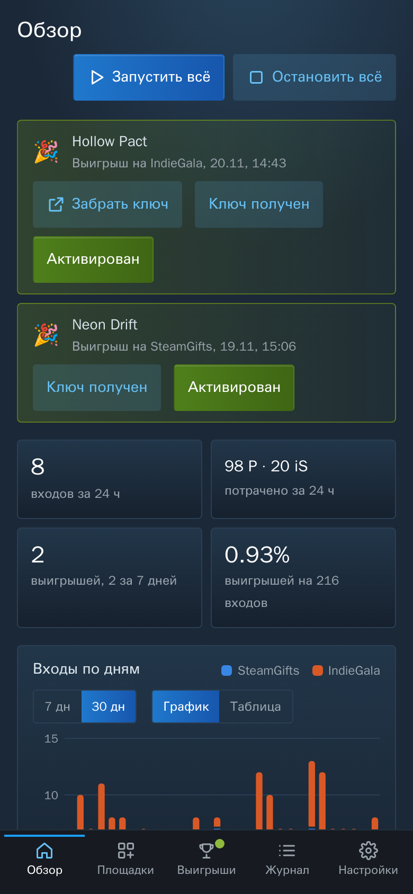

# Panel on your phone

The panel is an ordinary website. You can open it in your phone's browser and
add it to the home screen: then it opens like an app, in its own window,
without the address bar, with the farm's icon.



The panel addresses, "Copy" («Скопировать») buttons and these same
instructions are also in the panel itself: **Settings → Panel on your phone
(Настройки → Панель на телефоне)**.

## At home: Android

1. Connect the phone to your home Wi-Fi, the same network the server is on.
2. Open Chrome and enter the panel address, for example
   `http://192.168.1.10:8092/`. Sign in with the panel password; the phone
   stays signed in for 30 days.
3. The **⋮** menu at the top right → **"Add to Home screen"** (in some
   versions, "Install app").
4. Keep the name "Bot farm" («Бот-ферма») and press **"Add"**.

In other browsers:

- **Samsung Internet:** the ☰ menu → "Add page to" → "Home screen".
- **Yandex Browser:** ⋮ → "Add shortcut".
- **Firefox:** ⋮ → "Install" or "Add to Home screen".

## At home: iPhone and iPad

1. Connect the iPhone to your home Wi-Fi.
2. Open **Safari** and enter the panel address. It has to be Safari: other
   browsers on the iPhone cannot add sites to the Home Screen.
3. Tap **"Share"**, the square with an arrow pointing up.
4. Scroll down and choose **"Add to Home Screen"**, then **"Add"**.

## Away from home: Tailscale

The panel is not reachable from the internet, and that is by design. To open
it from any network, use [Tailscale](https://tailscale.com/), a free private
network between your devices.

1. On the server: install Tailscale, sign in and find the address with
   `tailscale ip -4`. It looks like `100.x.x.x`.
2. Add that address to the farm's `--host`, separated by a comma:
   `--host 192.168.1.10,100.64.0.5`. See [Server and service](Server-and-Service-EN.md).
3. On the phone: install the Tailscale app from Google Play or the App Store
   and sign in with the same account.
4. Open `http://100.x.x.x:8092/` and add it to the home screen as described
   above. It is handy to keep two icons: "home" and "away".

## As a full app (https)

When the panel is opened over `http://`, the browser adds it as a shortcut.
The shortcut works the same, but without an offline cache and without the
"Install app" option. A full installation needs https. The easiest way to get
it is through Tailscale:

```bash
sudo tailscale serve --bg 8092
```

Tailscale gives you an address like `https://server-name.tailnet-name.ts.net`
with a real certificate. Open it on the phone, and the browser offers to
install the app.

> For `tailscale serve`, the farm must listen on `127.0.0.1`, because
> Tailscale connects to it locally. Add `127.0.0.1` to `--host`.

## If it does not work

| Problem | What to do |
| --- | --- |
| The page does not open at home | is the phone on the same Wi-Fi, not a guest network or mobile data? Does the address start with `http://` and end with `:8092`? Is the port open in the server's firewall? |
| It does not open through Tailscale | does the Tailscale app say "Connected"? Is the server online in the device list? Is the Tailscale address in `--host`? |
| There is no "Install app" option | that is normal over http: add it as a shortcut. Installation needs https (see above) |
| It asks for the password every time | allow cookies for the site; do not open the panel in incognito mode |
| You lost your phone | **Settings → Security → Sign out on all other devices (Настройки → Безопасность → Выйти на всех других устройствах)** |
