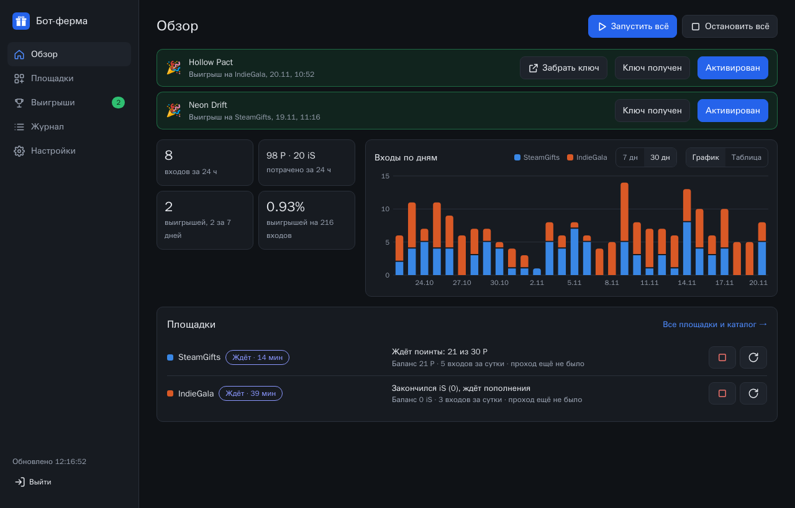
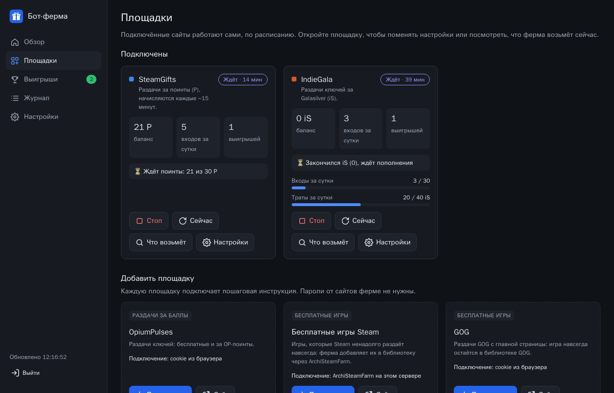
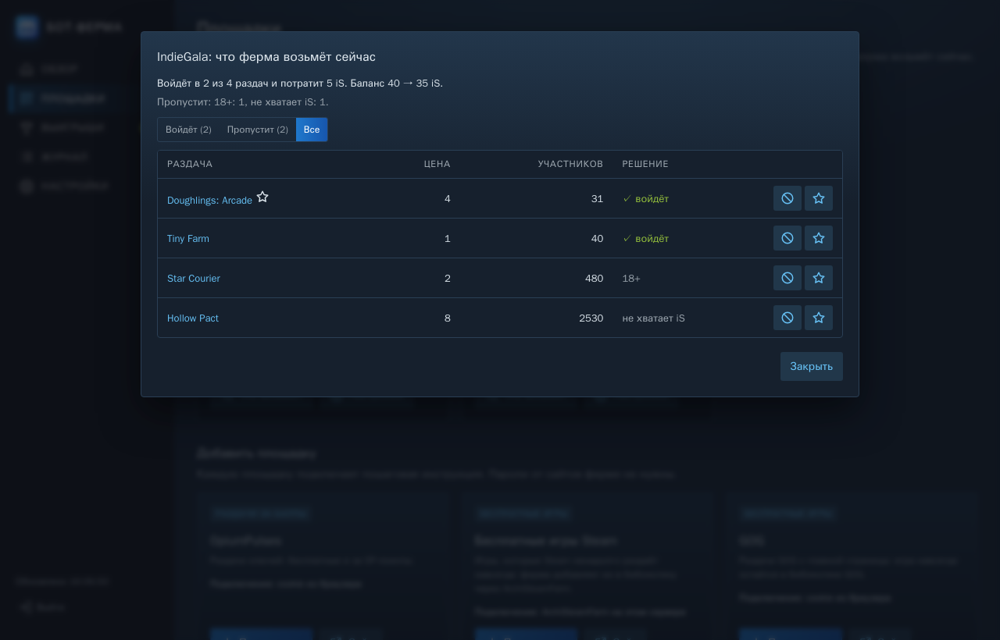

# Web panel

The panel is a single page with no build step and no external dependencies.
The section menu is on the left; on a phone it is a bar at the bottom of the
screen. The data refreshes every 3 seconds.

## Overview

- **New wins (Новые выигрыши)**: banners with the "Get key" («Забрать ключ»),
  "Key received" («Ключ получен») and "Activated" («Активирован») buttons. Up
  to three are shown; the rest are in the Wins (Выигрыши) section.
- **Last 24 hours (Цифры за сутки)**: entries in 24 hours, spending (in each
  site's currency), wins in total and over 7 days, and the share of wins
  among entries.
- **Entries per day (Входы по дням)**: a chart over 7 or 30 days, each site in
  its own colour. Hovering over a bar shows the day's entries, spending and
  wins. The "Table" («Таблица») toggle shows the same data as a list.
- **Sites (Площадки)**: one row for each connected site: status, reason for
  waiting, balance, and the "Start/Stop" («Старт/Стоп») and "Run now"
  («Пройти сейчас») buttons.
- **Start all / Stop all (Запустить всё / Остановить всё)**: all connected
  sites at once.

### Site statuses

| Label | What it means |
| --- | --- |
| Running (Работает) | a run is in progress |
| Waiting · 15 min (Ждёт · 15 мин) | a pause until the next run. The reason is shown next to it: "Waiting for points: 21 of 30 P" («Ждёт поинты: 21 из 30 P»), "Outside working hours, opens at 08:00" («Вне часов работы, откроется в 08:00»), "Daily limit reached, resets at 14:20" («Дневной лимит исчерпан, сброс в 14:20»), "Out of iS" («Закончился iS») |
| Stopped (Остановлена) | turned off by hand or never started |
| Error, retrying (Ошибка, повтор) | the site did not answer or answered unexpectedly. The farm retries by itself in 15 minutes |
| Sign-in required (Нужен вход заново) | the cookies no longer work. Press "Reconnect" («Подключить заново») |
| Not connected (Не подключена) | a site from the catalogue that has not been connected yet |

## Sites

Connected sites are at the top, and the "Add site" («Добавить площадку»)
catalogue is below them. Every connected site has its own page with four
tabs:

- **Status (Состояние)**: balance, entries in 24 hours, wins, last run,
  working hours, daily limit bars and the last 10 entries.
- **Settings (Настройки)**: presets and all of the site's settings, split
  into groups. Each one is described on that site's page in this wiki.
- **Preview (Что возьмёт)**: a trial run (see below).
- **Connection (Подключение)**: reconnect or disconnect.

### Preview

The trial run checks all current giveaways against the same rules as a real
run: filters, balance, reserve, daily limits. It shows which giveaways the
farm would enter and why it would skip the rest. It spends nothing and enters
nothing; it can take up to a minute.

- At the top is the summary: "Will enter 2 of 4 giveaways and spend 5 iS.
  Balance 40 → 35 iS" («Войдёт в 2 из 4 раздач и потратит 5 iS. Баланс 40 → 35
  iS»), and below it the reasons for skipping.
- The "Will enter / Will skip / All" («Войдёт / Пропустит / Все») filter.
- The 🚫 button next to a game adds it to the blacklist, ★ to the priority
  games.
- If it is outside working hours right now, a note says when the run will
  actually start.

## Wins

See [Wins and keys](Wins-and-Keys-EN.md).

## Log

See [Log and history](Log-and-History-EN.md).

## Settings

See [Farm settings](Farm-Settings-EN.md). That is where the time zone,
Telegram, the Steam library, ArchiSteamFarm, the panel password and the phone
instructions are.

## Keyboard and accessibility

- Every element can be reached with `Tab`; the focus outline is always
  visible.
- `Esc` closes a dialog, and focus does not escape it while it is open.
- On a phone, buttons are at least 44 pixels.
- Icon buttons have labels for screen readers, and the chart has a table with
  the same data.

## Unsaved changes

If the settings have unsaved edits, the section gets an "unsaved" («не
сохранено») label. When you go to another page, the panel asks you to
confirm.
