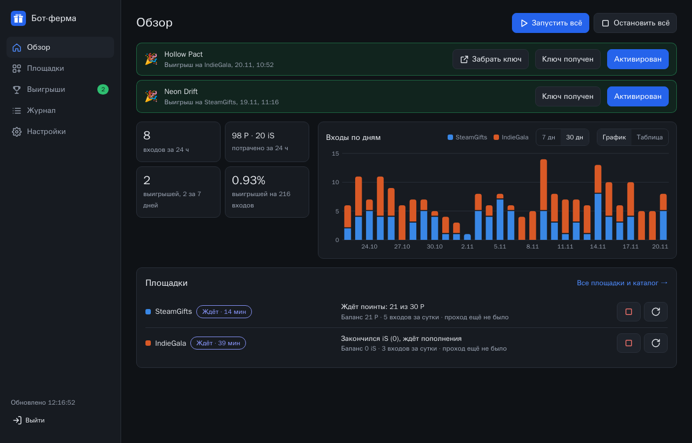
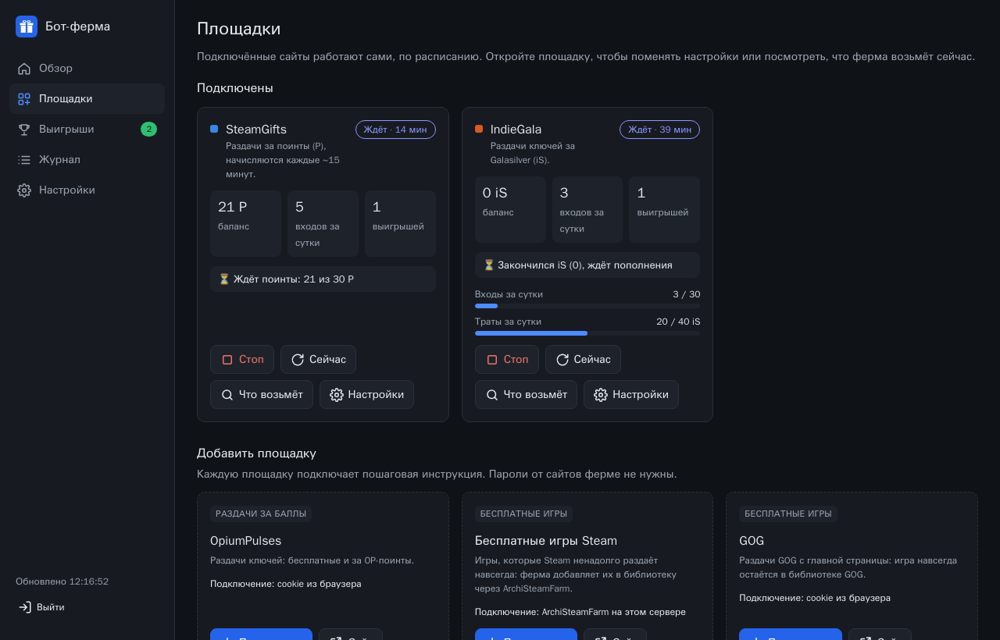
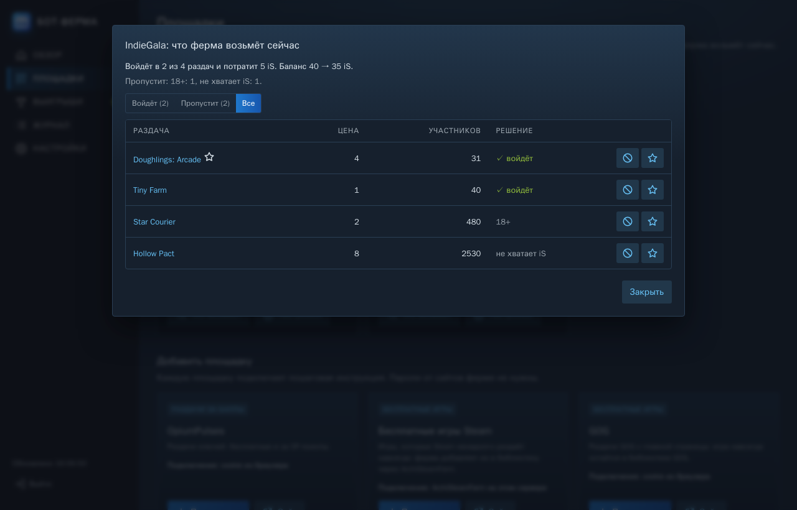

# Веб-панель

Панель — одна страница без сборки и без внешних зависимостей. Слева меню
разделов, на телефоне — панель внизу экрана. Данные обновляются каждые 3 секунды.

## Обзор

- **Новые выигрыши** — баннеры с кнопками «Забрать ключ», «Ключ получен» и
  «Активирован». Показываются до трёх, остальные — в разделе «Выигрыши».
- **Цифры за сутки** — входы за 24 часа, траты (по валюте каждой площадки),
  выигрыши всего и за 7 дней, доля выигрышей от входов.
- **Входы по дням** — график за 7 или 30 дней, у каждой площадки свой цвет.
  При наведении на столбик видны входы, траты и выигрыши за день. Переключатель
  «Таблица» показывает те же данные списком.
- **Площадки** — по строке на каждую подключённую площадку: состояние, причина
  ожидания, баланс, кнопки «Старт/Стоп» и «Пройти сейчас».
- **Запустить всё / Остановить всё** — все подключённые площадки сразу.

### Состояния площадки

| Метка | Что значит |
| --- | --- |
| Работает | идёт проход |
| Ждёт · 15 мин | пауза до следующего прохода. Причина написана рядом: «Ждёт поинты: 21 из 30 P», «Вне часов работы, откроется в 08:00», «Дневной лимит исчерпан, сброс в 14:20», «Закончился iS» |
| Остановлена | выключена вручную или не запускалась |
| Ошибка, повтор | сайт не ответил или ответил не так. Ферма повторит сама через 15 минут, а если до сайта не достучаться вовсе, сначала через 1, 2, 5 минут |
| Нужен вход заново | cookie больше не работают. Нажмите «Подключить заново» |
| Не подключена | площадка из каталога, которую ещё не подключили |

## Площадки

Сверху подключённые площадки, ниже каталог «Добавить площадку». У каждой
подключённой площадки своя страница с четырьмя вкладками:

- **Состояние** — баланс, входы за сутки, выигрыши, последний проход, часы
  работы, полоски дневных лимитов и последние 10 входов.
- **Настройки** — готовые наборы и все настройки площадки, разбитые на группы.
  Описание каждой — на странице площадки в этой вики.
- **Что возьмёт** — пробный проход (см. ниже).
- **Подключение** — подключить заново или отключить.

### Что возьмёт

Пробный проход проверяет все текущие раздачи по тем же правилам, что и
настоящий проход: фильтры, баланс, резерв, дневные лимиты. Он показывает, в
какие раздачи ферма вошла бы и почему пропустит остальные. Ничего не тратит и
никуда не входит; может занять до минуты.

- Сверху итог: «Войдёт в 2 из 4 раздач и потратит 5 iS. Баланс 40 → 35 iS», а
  ниже — причины пропусков.
- Фильтр «Войдёт / Пропустит / Все».
- Кнопка 🚫 рядом с игрой добавляет её в чёрный список, ★ — в приоритетные.
- Если сейчас нерабочие часы, будет пометка, когда проход начнётся на самом деле.

## Выигрыши

См. [Выигрыши и ключи](Выигрыши-и-ключи.md).

## Журнал

См. [Журнал и история](Журнал-и-история.md).

## Настройки

См. [Настройки фермы](Настройки-фермы.md). Там часовой пояс, Telegram,
библиотека Steam, ArchiSteamFarm, пароль панели и инструкция для телефона.

## Клавиатура и доступность

- По всем элементам можно пройти клавишей `Tab`; рамка фокуса всегда видна.
- `Esc` закрывает окно, а фокус при этом не уходит за его пределы.
- На телефоне кнопки не меньше 44 пикселей.
- У кнопок-иконок есть подписи для экранных чтецов, у графика — таблица с теми
  же данными.

## Несохранённые изменения

Если в настройках есть несохранённые правки, у раздела появляется метка «не
сохранено». При переходе на другую страницу панель переспросит.
