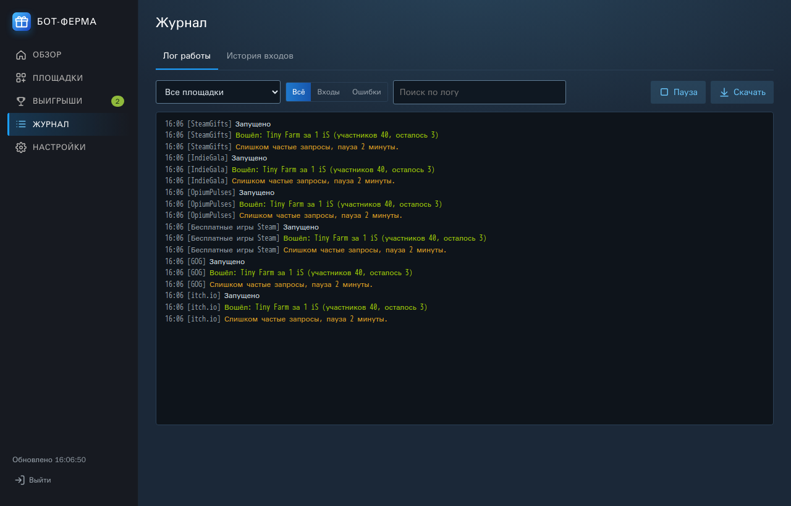

# Журнал и история

Раздел **Журнал** состоит из двух вкладок.

## Лог работы

Последние строки лога всех площадок вместе, в порядке времени. Перед каждой
строкой указана площадка.

- **Площадка** — показать только одну площадку.
- **Всё / Входы / Ошибки / Подробно** — все строки, только входы в раздачи,
  только предупреждения и ошибки или всё вместе с причиной пропуска каждой
  раздачи («Пропуск: Название — дороже лимита»). Строки «Подробно» есть только в
  панели, в файл лога они не пишутся.
- **Поиск** — строки, в которых есть все введённые слова.
- **Пауза** — остановить обновление, чтобы спокойно прочитать.
- **Скачать** — сохранить показанные строки в `botfarm-log.txt`.

Входы выделены зелёным, предупреждения — жёлтым, ошибки — красным. У каждой
строки есть время с секундами, а у строк прошлых дней ещё и дата; полная дата
видна при наведении.

**Подробности входа.** Строку входа (со стрелкой ▸) можно раскрыть: там цена,
баланс после входа, число участников, сколько входов за сутки и ссылка на саму
раздачу. Конец прохода пишется так: «Проход окончен: вошёл в 3, баланс 4 iS ·
за 12 с».

**После перезапуска** журнал не пустой: ферма подтягивает последние строки из
`log/botfarm.log`. Они чуть бледнее, а там, где начинается текущая работа, стоит
черта «перезапуск фермы».

В памяти хранятся последние 600 строк каждой площадки и ещё 1500 строк
«Подробно». Полный лог на диске —
в папке `log/` (см. [Файлы и данные](Файлы-и-данные.md)), а у службы ещё и
`journalctl -u botfarm`.

## История входов

Все входы всех площадок: когда, площадка, раздача (со ссылкой) и цена.

- **Площадка** и **поиск по названию** (нужны все слова).
- По 50 строк на страницу.
- **Скачать CSV** — выгрузка с текущими фильтрами, со столбцами «Когда»,
  «Площадка», «Название», «Цена», «Ссылка». Разделитель — точка с запятой,
  кодировка UTF-8 с BOM, поэтому Excel открывает файл двойным щелчком без
  кракозябр.
- Кнопки 🚫 и ★ в каждой строке добавляют игру в чёрный список или в
  приоритетные.

Ферма хранит до 2000 последних входов каждой площадки. Счётчики по дням для
графика на «Обзоре» хранятся отдельно, за 120 дней, поэтому график не
обрезается, даже когда старые входы удаляются из истории.

## История бота командной строки

Если до фермы SteamGifts вёл бот командной строки, ферма один раз при запуске
читает его логи `log/log-*.log` и добавляет в статистику его входы по дням и его
выигрыши. Поэтому график «Входы по дням» начинается не с дня запуска фермы.
Цен раздач в тех логах нет, так что траты за такие дни показаны как «?».
Выигрыши приходят со статусом «Ключ получен»: о них в своё время уже пришло
сообщение в Telegram.
