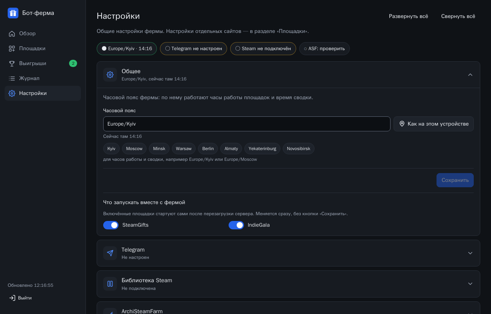

# Настройки фермы

Раздел **Настройки** — общие настройки всей фермы. Настройки отдельных сайтов
находятся в разделе **Площадки**, на странице каждой площадки.

## Как устроена страница

- **Строка состояния вверху** показывает часовой пояс и время в нём, настроен ли
  Telegram, подключён ли Steam, и даёт проверить ASF. Нажатие открывает нужный
  раздел.
- **Разделы сворачиваются.** Панель запоминает, какие из них вы оставили
  открытыми. Вверху есть «Развернуть всё» и «Свернуть всё».
- **У каждого раздела своя кнопка «Сохранить».** Она загорается, только когда
  что-то изменено. Изменения действуют сразу, без перезапуска фермы.
- **Сохранённые секреты** (токены, ключи, пароли) показываются как
  «✓ Сохранено» с кнопкой «Заменить». Обратно в браузер они не отдаются никогда.

## Общее

- **Часовой пояс.** Можно выбрать из полного списка (начните вводить город
  по-английски: Kyiv, Moscow, Almaty), нажать «Как на этом устройстве» или
  одну из кнопок с частыми поясами. Под полем видно, сколько сейчас времени в
  выбранном поясе.
- **Что запускать вместе с фермой.** Переключатель для каждой подключённой
  площадки. Включённые площадки стартуют сами после перезапуска фермы или
  сервера. Изменение действует сразу, кнопка «Сохранить» не нужна.

## Все настройки

<!-- settings:farm -->
**Общее**

| Настройка | По умолчанию | Что делает |
| --- | --- | --- |
| Часовой пояс | `Europe/Kyiv` | для часов работы и сводки, например Europe/Kyiv или Europe/Moscow |

**Библиотека Steam**

| Настройка | По умолчанию | Что делает |
| --- | --- | --- |
| Steam Web API key | — | steamcommunity.com/dev/apikey — нужен, чтобы пропускать игры, которые у вас уже есть |
| Профиль Steam | пусто | SteamID64 или ссылка на профиль; «Игровые данные» должны быть открыты |
| Сначала игры из списка желаемого | выкл | IndieGala берёт их первыми (и может тратить резерв), SteamGifts начинает каждый проход с раздела «Wishlist»; список желаемого должен быть открыт |

**ArchiSteamFarm**

| Настройка | По умолчанию | Что делает |
| --- | --- | --- |
| Адрес IPC | `http://127.0.0.1:1242` | если ASF на этом же сервере — оставьте как есть |
| Пароль IPC | — | IPCPassword из config/ASF.json; пусто — ферма прочитает его из ~/asf/config/ASF.json сама |
| Бот для ключей | пусто | имя бота ASF; пусто — первый бот в сети |
| Активировать выигранные ключи сразу | выкл | как только у выигрыша появится ключ, ASF активирует его, а в Telegram придёт результат |

**Telegram**

| Настройка | По умолчанию | Что делает |
| --- | --- | --- |
| Токен бота | — | создайте бота у @BotFather командой /newbot и вставьте токен, который он пришлёт |
| ID чата | пусто | напишите боту любое сообщение и нажмите «Найти мой чат» |
| Присылать уведомления | вкл | выигрыши, ошибки, слетевшие cookie |
| Управлять фермой командами | выкл | /status, /pause, /start, /run, /preview, /wins, /report — отвечает только в этот чат |
| Присылать сводку за сутки | выкл | входы, траты, выигрыши и баланс по каждой площадке |
| Час отправки сводки | `21` | 0–23, по часовому поясу фермы |
<!-- /settings -->

Настройки Telegram (токен, чат, «Присылать уведомления») хранятся в
`config.ini`, потому что ими пользуется и бот для командной строки. Остальные —
в `farm.json`.

## Кнопки проверки

| Кнопка | Что делает |
| --- | --- |
| Telegram → «Найти мой чат» | показывает чаты, где боту писали; выбранный подставляется в поле |
| Telegram → «Отправить тест» | присылает тестовое сообщение |
| Telegram → «Прислать сводку сейчас» | присылает сводку за сутки, не дожидаясь часа отправки |
| Библиотека Steam → «Проверить» | показывает, сколько игр в библиотеке и в списке желаемого, или почему не получилось их прочитать |
| ArchiSteamFarm → «Проверить ASF» | показывает ботов ASF и кто из них в сети |

## Безопасность

- **Сменить пароль** — нужно ввести текущий и новый (не короче 6 символов).
  После смены все остальные устройства выходят из панели.
- **Выйти на всех других устройствах** — то же, но пароль остаётся прежним.
  Пригодится, если потерялся телефон.

## Панель на телефоне и «О ферме»

Пошаговая инструкция описана на странице [Панель на телефоне](Панель-на-телефоне.md).
В разделе «О ферме» — время запуска, адреса панели, сколько площадок
подключено и время по часовому поясу фермы.
