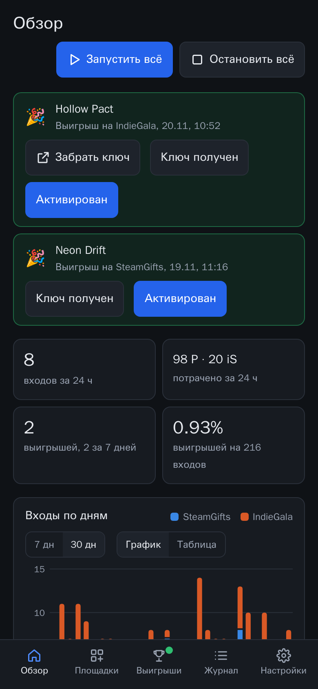

# Панель на телефоне

Панель — обычный сайт. Её можно открыть в браузере телефона и добавить на
главный экран: тогда она будет открываться как приложение — отдельным окном,
без адресной строки, с иконкой фермы.



Адреса панели, кнопки «Скопировать» и та же инструкция есть в самой панели:
**Настройки → Панель на телефоне**.

## Дома: Android

1. Подключите телефон к домашнему Wi-Fi — к той же сети, что и сервер.
2. Откройте Chrome и введите адрес панели, например `http://192.168.1.10:8092/`.
   Войдите с паролем панели — телефон запомнит вход на 30 дней.
3. Меню **⋮** справа вверху → **«Добавить на главный экран»** (в некоторых
   версиях — «Установить приложение»).
4. Оставьте название «Бот-ферма» и нажмите **«Добавить»**.

В других браузерах:

- **Samsung Internet:** меню ☰ → «Добавить страницу на» → «Главный экран».
- **Яндекс Браузер:** ⋮ → «Добавить ярлык».
- **Firefox:** ⋮ → «Установить» или «Добавить на главный экран».

## Дома: iPhone и iPad

1. Подключите iPhone к домашнему Wi-Fi.
2. Откройте **Safari** и введите адрес панели. Именно Safari: другие браузеры
   на iPhone не умеют добавлять сайты на экран «Домой».
3. Нажмите **«Поделиться»** — квадрат со стрелкой вверх.
4. Прокрутите вниз и выберите **«На экран “Домой”»**, затем **«Добавить»**.

## Вне дома: Tailscale

Из интернета панель недоступна, и так и задумано. Чтобы открыть её из любой
сети, используйте [Tailscale](https://tailscale.com/) — бесплатную частную сеть
между вашими устройствами.

1. На сервере: установите Tailscale, войдите в аккаунт и узнайте адрес командой
   `tailscale ip -4`. Он вида `100.x.x.x`.
2. Добавьте этот адрес в `--host` фермы через запятую:
   `--host 192.168.1.10,100.64.0.5`. См. [Сервер и служба](Сервер-и-служба.md).
3. На телефоне: установите приложение Tailscale из Google Play или App Store и
   войдите тем же аккаунтом.
4. Откройте `http://100.x.x.x:8092/` и добавьте его на главный экран так же, как
   выше. Удобно держать две иконки: «дома» и «вне дома».

## Как полноценное приложение (https)

Когда панель открыта по `http://`, браузер добавляет её как ярлык. Работает он
так же, но без кэша на случай отсутствия связи и без пункта «Установить
приложение». Для полноценной установки нужен https. Проще всего получить его
через Tailscale:

```bash
sudo tailscale serve --bg 8092
```

Tailscale выдаст адрес вида `https://имя-сервера.имя-сети.ts.net` с настоящим
сертификатом. Откройте его на телефоне, и браузер предложит установить
приложение.

> Для `tailscale serve` ферма должна слушать `127.0.0.1`, потому что Tailscale
> обращается к ней локально. Добавьте `127.0.0.1` в `--host`.

## Если не получается

| Проблема | Что делать |
| --- | --- |
| Дома страница не открывается | телефон в той же Wi-Fi, а не в гостевой сети и не на мобильном интернете? Адрес начинается с `http://` и заканчивается на `:8092`? Порт открыт в фаерволе сервера? |
| Через Tailscale не открывается | в приложении Tailscale «Connected»? Сервер в списке устройств онлайн? Адрес Tailscale указан в `--host`? |
| Нет пункта «Установить приложение» | по http это нормально: добавьте как ярлык. Для установки нужен https (см. выше) |
| Каждый раз спрашивает пароль | разрешите сайту cookie; не открывайте панель в режиме инкогнито |
| Потеряли телефон | **Настройки → Безопасность → Выйти на всех других устройствах** |
