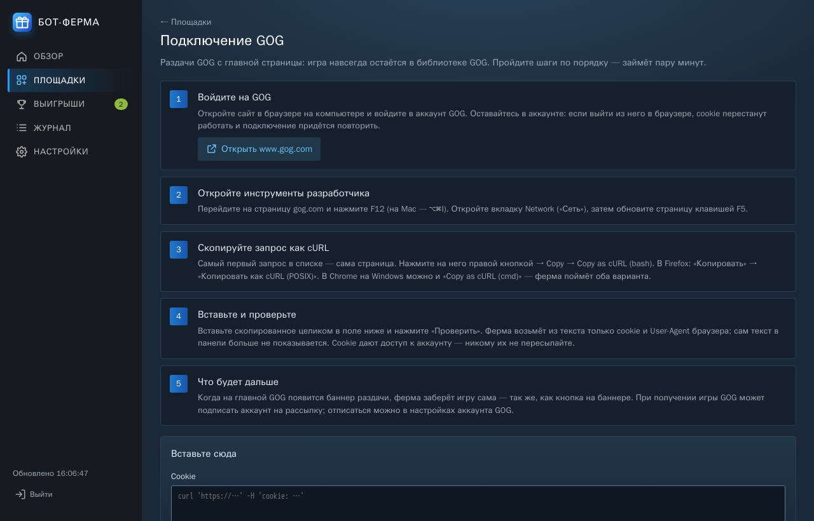

# Подключение площадок

Ферма входит на сайты под вашим аккаунтом, но пароли от них ей не нужны. Она
использует cookie — короткие строки, по которым сайт узнаёт, что вы уже вошли.
Их нужно один раз скопировать из браузера.

Исключение — [Бесплатные игры Steam](Бесплатные-игры-Steam.md): эта площадка
работает через ArchiSteamFarm, и cookie для неё не нужны.

## Как это выглядит в панели

1. **Площадки → Добавить площадку → Подключить** у нужного сайта.
2. Мастер показывает шаги: войти на сайт, открыть инструменты разработчика,
   скопировать запрос.
3. Вставьте скопированное в поле и нажмите **Проверить подключение**. Ферма
   войдёт на сайт, ничего не сохраняя, и покажет аккаунт и баланс.
4. Выберите набор настроек (см. [Правила и фильтры](Правила-и-фильтры.md#готовые-наборы))
   и нажмите **Сохранить и запустить**.

## Как скопировать запрос как cURL

Делайте это на компьютере: в мобильных браузерах нет инструментов разработчика.

### Chrome, Edge, Яндекс Браузер, Opera, Brave

1. Откройте сайт и войдите в аккаунт.
2. Нажмите `F12`, на Mac — `⌥⌘I`. Можно и так: правой кнопкой по странице →
   «Просмотреть код».
3. Откройте вкладку **Network** («Сеть»). Если её не видно, нажмите `»` в ряду
   вкладок.
4. Обновите страницу клавишей `F5`.
5. Прокрутите список запросов в самый верх. Первая строка — сама страница,
   например `giveaways` или `www.indiegala.com`.
6. Правой кнопкой по ней → **Copy** → **Copy as cURL (bash)**. На Windows
   подойдёт и **Copy as cURL (cmd)**.
7. Вставьте в поле в панели (`Ctrl+V`).

### Firefox

1. Войдите на сайт, нажмите `F12` и откройте вкладку **Сеть**.
2. Обновите страницу (`F5`).
3. Правой кнопкой по первому запросу → **Копировать значение** →
   **Копировать как cURL (POSIX)**.

### Safari

1. Включите меню разработчика: **Safari → Настройки → Дополнения → «Показывать
   функции для веб-разработчиков»**.
2. **Разработка → Показать веб-инспектор → Сеть**, затем обновите страницу.
3. Правой кнопкой по первому запросу → **Скопировать как cURL**.

## Что ещё можно вставить

Ферма понимает несколько форматов. Подойдёт любой:

| Формат | Откуда взять |
| --- | --- |
| cURL (bash или cmd) | инструменты разработчика, как описано выше. **Рекомендуется:** вместе с cookie ферма возьмёт и User-Agent вашего браузера |
| JSON | расширение Cookie-Editor → Export → JSON |
| Netscape `cookies.txt` | расширения вида «Get cookies.txt» |
| Строка `Cookie: a=1; b=2` | заголовок запроса во вкладке Network |
| Одно значение | только для SteamGifts: значение `PHPSESSID` |

Из вставленного текста ферма сохраняет только cookie и User-Agent. Остальное
она отбрасывает, и в панели этот текст больше нигде не показывается.

## Важно

- **Не выходите из аккаунта в браузере.** Кнопка «Выйти» на сайте делает cookie
  недействительными, и подключение придётся повторить. Просто закройте вкладку.
- **Берите cookie из того же браузера, где вошли.** IndieGala защищена
  Incapsula и сверяет cookie с браузером, поэтому ферме нужен и User-Agent. При
  копировании как cURL он берётся автоматически.
- **Cookie дают доступ к аккаунту.** Не отправляйте их никому и не публикуйте
  скриншоты с ними.
- **Cookie со временем перестают работать.** Обычно через несколько недель. Тогда
  карточка площадки станет красной с кнопкой **Подключить заново**, а в Telegram
  придёт сообщение. Повторите те же шаги.

## Если проверка не проходит

| Ответ панели | Что делать |
| --- | --- |
| «В тексте нет cookie» | скопирован не тот запрос или не целиком. Возьмите самый первый запрос страницы и вставьте его полностью |
| «… не узнаёт cookie» | в браузере вы не вошли на сайт, или вошли в другом окне, например в режиме инкогнито. Войдите, обновите страницу и скопируйте запрос заново |
| «IndieGala показала проверку Incapsula» | откройте сайт в браузере, пройдите проверку и скопируйте запрос как cURL заново |
| «В cookie нет itchio» | вы не вошли на itch.io, либо скопировали запрос не с itch.io |
| «… недоступен» / «HTTP 5xx» | сайт временно не работает, попробуйте позже |

## Обновить cookie или отключить площадку

Откройте площадку → вкладка **«Подключение»**:

- **Подключить заново** — тот же мастер. Настройки и история сохранятся.
- **Отключить** — ферма остановит площадку и забудет cookie. История и
  настройки останутся, подключить снова можно в любой момент.

## Вторая учётка того же сайта

Её подключают так же, только запрос копируют из другого профиля браузера или
окна инкогнито, где открыта вторая учётка. Подробно — в
[«Несколько учёток»](Несколько-учёток.md).
